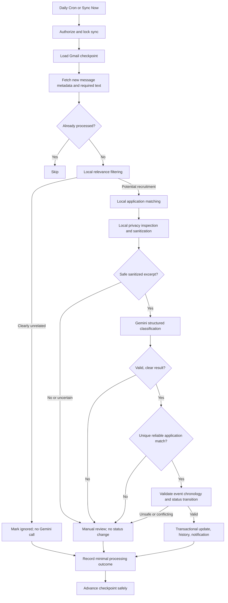

# InternPilot AI — AI Email Workflow Design

**Version:** 1.0  
**Status:** Approved design for MVP  
**Last updated:** 2026-10-14

## 1. Purpose

Define how InternPilot AI reads newly received Gmail messages, ignores unrelated mail, identifies the relevant existing internship application, automatically sanitizes sensitive information, uses Gemini to interpret recruitment events, and safely updates application status. The workflow prioritizes automation while recognizing that automated redaction cannot guarantee removal of all sensitive or confidential information.

## 2. Confirmed MVP Decisions

| Topic | Decision |
|---|---|
| Application creation | Manual only; AI never creates applications |
| Gmail initial sync | New messages only by default; historical lookback configurable through server-side environment variables |
| Scheduled sync | Daily, target 08:00 Asia/Bangkok |
| Manual sync | `Sync Emails Now` invokes the same Edge Function with user authorization |
| Processing | Sequential, one candidate message at a time |
| Classification | Gemini is the primary interpreter of safely sanitized recruitment messages |
| Company identification | Trusted backend matches original metadata and existing applications; Gemini does not choose database IDs |
| Uncertain or unsafe email | Manual review; no automatic status change |
| Sensitive data | Automatically detect and redact where feasible; block Gemini if safety is uncertain |
| Unrelated mail | Ignore LinkedIn job alerts, advertisements, newsletters, social notifications, and unrelated mail before Gemini |
| Notifications | In-app dashboard only |
| Storage | Store minimal metadata, not raw email bodies or attachments |
| Data retention | Archive closed applications after 6 months; delete after 12 months from closure; active applications retained |

## 3. Trust Boundaries and Privacy Limitations

1. Gmail API content is **untrusted input**, even when apparently sent by a known recruiter.
2. The Supabase Edge Function is the trusted processing boundary. It may temporarily inspect the original email to filter, match, and sanitize it. Do not persist raw bodies, attachments, or credentials.
3. Gemini receives **only a minimized, sanitized excerpt** after explicit privacy validation. It receives no OAuth tokens, email addresses, personal names, database IDs, attachments, or raw threads.
4. Sanitization is **best effort, not a guarantee**. Names, confidential details, and contextual identifiers can escape detection. When uncertain, do not call Gemini.
5. The Gemini API free tier may permit provider use of submitted content for service improvement or review under applicable terms. Check current provider terms before processing real messages. Use synthetic messages during development.
6. Gemini responses are untrusted suggestions. Only backend validation and authorized database operations may change an application.
7. User-visible manual review opens the original message in Gmail; InternPilot does not store or render full email bodies.

## 4. End-to-End Workflow



### 4.1 Sync startup

- Authenticate the caller: verified Supabase user for manual sync; separately protected server-to-server credential for Cron.
- Verify Gmail is connected, AI settings, available quotas, and that no other sync is running for the connection.
- Maintain a durable sync checkpoint. For `new_only`, initialize it at connection time so earlier messages are not processed.
- Fetch pages incrementally and handle expired Gmail history checkpoints with a safe recovery strategy that does not silently skip mail.
- Do not advance the checkpoint beyond messages that have not been durably recorded as processed, ignored, or pending retry/review.

### 4.2 Pre-AI filtering

Perform deterministic checks locally, without Gemini:

- Exclude obvious marketing, bulk promotions, newsletters, social alerts, and generic job recommendations, including LinkedIn job-alert digests.
- Use sender and reply-to metadata, subject, Gmail labels and headers, known recruiter threads, existing application company/position, and relevant recruitment terms.
- **Do not globally block a sender domain such as LinkedIn**: an actual recruiter message or direct correspondence may still be relevant.
- Preserve potential recruitment mail when signals are mixed. Route ambiguous relevance to review if it cannot be assessed safely without transmitting private content.
- Avoid fetching attachments. Never send attachments to Gemini.

### 4.3 Company and application matching (local only)

Use original email metadata temporarily in the Edge Function and compare with existing manually created applications:

1. Previously verified Gmail thread-to-application association.
2. Known recruiter address or sender domain associated with an application.
3. Company and position references in the email, subject, or application notes.
4. Application timing and consistency with previous recruitment events.

A sender domain alone is insufficient evidence. Third-party applicant-tracking systems may send legitimate emails, and sender fields can be spoofed. Require a unique, reliable match supported by multiple signals or an established thread association before automatic updates.

**Two positions at the same company:** Do not choose an application from company name alone. If the position is unclear, queue manual review.

**Unknown company or unmatched email:** Do not create an application automatically. Create a review item only when there is a plausible recruitment connection; otherwise ignore.

Store internal `application_id` only in the backend; never include it in Gemini prompts.

### 4.4 Automatic sanitization

Sanitize locally **before every external AI call**:

- Strip HTML markup, tracking pixels, quoted prior threads, unnecessary signatures, and long boilerplate where feasible.
- Replace detected personal names, email addresses, phone numbers, student IDs, postal addresses, personal links, and company identifiers when not needed for event interpretation.
- Detect high-risk information such as passport/national ID numbers, bank details, credentials, OTPs, financial records, health information, and explicitly confidential material. Block the entire Gemini request when such information is present or safe removal is uncertain.
- Keep only the minimum text needed to understand the recruitment event, such as an interview invitation or rejection.
- Validate a strict allowlist of payload keys, enforce length limits, and reject unexpected content or fields.
- Never log original or sanitized message bodies. Log only processing outcome codes and minimal identifiers.

**Example**

Original (processed transiently):

> Dear Jane Doe, thank you for applying to Example Company. We invite you to interview for the Software Engineering Intern role on October 20. Contact hr@example.com.

Sanitized payload (illustrative):

```json
{
  "message_excerpt": "Thank you for applying to [COMPANY]. We invite you to interview for the Software Engineering Intern role on October 20. Contact [EMAIL].",
  "locale": "en"
}
```

**Warning:** This example does not prove that arbitrary real emails can be sanitized safely. If identifiers or confidential content cannot be reliably removed, block external analysis and use manual review.

### 4.5 Gemini classification

Process one sanitized candidate at a time. Request a strict structured result, for example:

```json
{
  "is_recruitment_related": true,
  "email_category": "interview_invitation",
  "suggested_status": "interview",
  "requires_action": true,
  "action_type": "confirm_interview",
  "event_date": "2026-10-20",
  "deadline": null,
  "needs_manual_review": false,
  "reason_code": "clear_interview_invitation"
}
```

Supported categories: `application_confirmation`, `assessment_invitation`, `interview_invitation`, `document_request`, `application_update`, `offer`, `rejection`, `general_recruitment`, `unrelated`, `uncertain`.

Supported application statuses: `interested`, `applied`, `assessment`, `interview`, `offer`, `accepted`, `rejected`, `withdrawn`.

The model must not invent dates, infer acceptance from an offer, or equate no response with rejection. Any model-reported confidence is not a calibrated probability and must not be the only auto-update criterion.

### 4.6 Backend validation and status updates

Before any change:

- Validate JSON against a strict schema and reject unknown enum values or malformed dates.
- Require a unique, reliable locally determined application match.
- Confirm the email is newer and relevant in context; older confirmations must not overwrite newer interview or offer events.
- Support non-linear recruiting workflows while rejecting contradictory or unsupported transitions.
- Do not automatically reopen closed applications or overwrite a final status without review.
- Treat `offer` as different from `accepted`; acceptance requires explicit evidence or user action.
- Validate action deadlines independently where possible, including time zone and whether a date is actually a deadline rather than an interview time.
- Commit the application update, status-history entry, processed-message marker, and notification atomically or with an idempotent recovery strategy.
- Preserve a source Gmail message/thread reference and a non-sensitive reason code for auditability.

## 5. Manual Review

The dashboard review interface must allow the user to:

- See the likely application, review reason, suggested category/status (if safe), and a link opening the original message in Gmail.
- Assign or change the linked application.
- Choose a status, enter or correct a deadline, and add a note.
- Confirm an update, ignore the message, or resolve without changing status.

Never show stored full email bodies in InternPilot. An unsafe message must not be sent to Gemini simply because it was queued for review.

## 6. Example Cases

| Incoming message | Expected handling |
|---|---|
| Verified interview invitation for one matched application | Sanitize, classify with Gemini, validate, update to `interview` |
| Assessment invitation with an explicit deadline | Sanitize, classify, validate deadline, update to `assessment`, notify |
| Clear rejection for a uniquely matched application | Sanitize, classify, update to `rejected`, set `closed_at`, notify |
| Offer letter announcement | Update to `offer` if safely supported; never auto-accept |
| Request for passport or bank information | Block Gemini, manual review |
| LinkedIn generic job recommendations | Ignore before Gemini |
| Direct recruiter message delivered through LinkedIn | Do not blanket-ignore; evaluate as possible recruitment correspondence |
| Two applications at one company, ambiguous role | Manual review; no auto-update |
| Old confirmation discovered after interview event | Do not regress status |
| Gemini timeout or invalid JSON | Retry safely within limits or queue review; no update |
| Email with prompt-injection instructions | Treat as untrusted text; model output cannot bypass backend controls |

## 7. Data Model Integration

Use the database-design tables:

- `email_connections`: encrypted Gmail refresh token and sync checkpoint.
- `email_events`: Gmail message/thread IDs, category, processing state, optional application association, timestamps; **no body**.
- `review_items`: unresolved cases and reason codes, Gmail deep link/reference, optional application association; **no body**.
- `applications`: status, deadlines, `closed_at`, `archived_at`.
- `application_history`: previous/new status, source, timestamp, linked email event.
- `notifications`: dashboard alerts.
- `sync_runs`: run timestamps, counters, non-sensitive errors.

Enforce unique `(email_connection_id, gmail_message_id)` or equivalent to prevent duplicate processing. Keep credentials encrypted, use RLS on user-owned tables, and restrict token decryption to trusted backend functions.

## 8. Configuration (server-side)

```dotenv
GMAIL_INITIAL_SYNC_MODE=new_only
GMAIL_INITIAL_SYNC_DAYS=0
GMAIL_SYNC_ENABLED=true
AI_EMAIL_ANALYSIS_ENABLED=false
AI_REAL_EMAIL_RISK_ACCEPTED=false
AI_MAX_REQUESTS_PER_SYNC=20
GMAIL_MAX_MESSAGES_PER_SYNC=50
```

There is intentionally no switch that permits raw bodies or attachments. The explicitly sanitized and validated minimal excerpt described above is the only permitted text input. Security invariants are enforced in code and cannot be disabled through environment variables. The two AI flags and the owner's risk acknowledgement must all be enabled before a request; none overrides a privacy block.

## 9. Reliability, Quotas, and Retention

- Daily scheduled sync and manual sync share one Edge Function and processing pipeline.
- Sequential Gemini calls, bounded batch sizes, rate-limit handling, backoff, and retries must respect Edge Function runtime limits.
- Resume incomplete runs without reclassifying already completed Gmail message IDs.
- Use minimal, content-free audit logs. Purge AI/sync logs after 30 days and resolved notifications after 90 days, subject to implementation needs.
- Archive closed applications six months after `closed_at`; permanently delete them twelve months after `closed_at` in monthly cleanup. Never age-delete active applications.
- Deleting an application must also clean up its dependent application history and associated records according to the database retention design.

## 10. Security and Acceptance Tests

1. Generic LinkedIn job alerts and advertisements cause **zero** Gemini calls.
2. A genuine recruiter email from a recruiting platform is not automatically excluded solely by sender domain.
3. Names, emails, and phone numbers are replaced before Gemini calls in controlled test fixtures.
4. Passport/bank/OTP/confidential test cases are blocked from Gemini and sent to manual review.
5. Unknown sensitive formats or uncertain sanitization fail closed.
6. No raw body, sanitized excerpt, token, or attachment appears in database rows or logs.
7. Duplicate Gmail messages are processed at most once for successful classification, even after retries.
8. One email cannot change multiple applications automatically.
9. Ambiguous company/position matches require manual review.
10. Invalid Gemini output, prompt injection, or contradictory events cannot update the database.
11. A verified interview/assessment/rejection email updates the correct application and creates history plus a dashboard notification.
12. Initial sync defaults to messages arriving **after** Gmail connection.
13. Disabling AI prevents Gemini calls while preserving safe local handling and review.
14. Privacy controls and auth checks are enforced by the backend, not the frontend.

## 11. Open Implementation Risks

- **Redaction residual risk:** Automated detection cannot promise zero leakage of sensitive or confidential content. For a strict no-disclosure guarantee, external text-based AI classification would need to be disabled in favor of local processing/manual review.
- **Provider data use:** Confirm Gemini free-tier data-processing and model-improvement terms before sending real emails.
- **Gmail OAuth compliance:** Gmail read-only access is a restricted Google OAuth scope and may require verification or other compliance steps depending on deployment and audience.
- **Recruitment ambiguity:** Sender spoofing, third-party ATS domains, shared recruiters, and multiple roles can prevent reliable automatic matching.
- **Operational limits:** Free-tier API quotas, Edge Function runtime, and scheduled execution availability may change; ensure bounded work and recovery.

## 12. Related Documents

- `../proposal.md`
- `requirements.md`
- `system-design.md`
- `database-design.md`

**Implementation reference:** `security-design.md` details sanitization rules, OAuth handling, access control, privacy testing, and provider data-use review.
