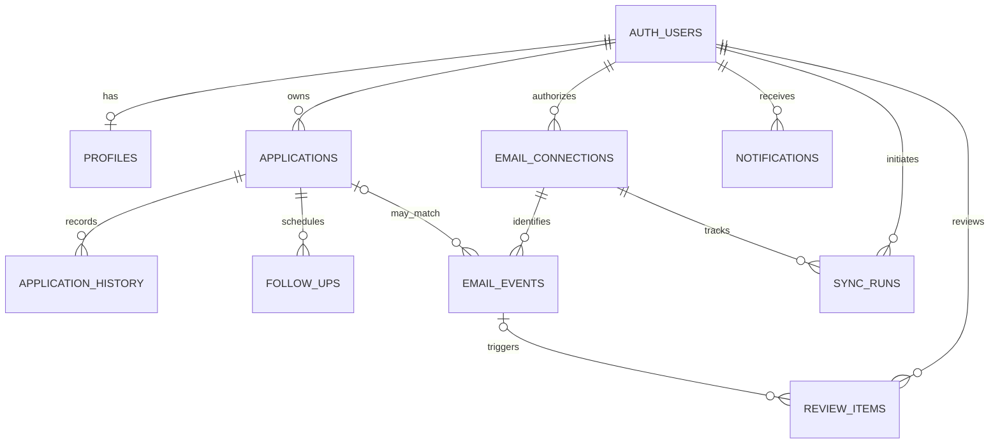

# InternPilot AI — Database Design

**Version:** 1.1  
**Date:** 14 October 2026  
**Status:** Design baseline; migrations not yet implemented  
**Database:** Supabase PostgreSQL  
**Related documents:** `proposal.md`, `docs/requirements.md`, `docs/system-design.md`

## 1. Purpose and Confirmed Decisions

This document specifies the logical and physical data model for InternPilot AI, a single-user internship application tracker. The frontend uses Supabase directly for authorized application operations; trusted Supabase Edge Functions handle Gmail OAuth, synchronization, privacy inspection, AI processing, and maintenance.

| Decision | Selected approach |
|---|---|
| Application status | `TEXT` with PostgreSQL `CHECK` constraint |
| Gmail storage | Metadata only; **no message bodies, snippets, attachments, or full subjects** |
| Application history | Full status-change history, retained until parent application deletion |
| Archiving | Same `applications` table, using `archived_at` |
| Primary keys | UUID |
| Access control | Supabase Auth + RLS; restrict access to the designated user |
| Gmail AI privacy | Never send personal, sensitive, or confidential email content to Gemini; fail closed |
| Retention | Archive closed applications after 6 months; delete after 12 months from closure |

**Security boundary:** RLS alone does not protect columns from an authenticated user who has broad `UPDATE` privileges. Privileged columns, history integrity, Gmail tokens, and automatic status updates require restricted grants, database functions, and/or trusted Edge Functions.

## 2. Entity Overview

Nine application-owned tables are proposed. Supabase manages `auth.users`; it is not duplicated as a custom authentication table.

| Table | Responsibility | Browser access |
|---|---|---|
| `profiles` | Single-user preferences and display timezone | Own row: read; limited update |
| `applications` | Internship details, current status, archive state | Own rows: read and controlled writes |
| `email_connections` | Encrypted Gmail refresh token and durable sync checkpoint | No direct access; backend only |
| `email_events` | Gmail message identifiers, processing outcome, safe structured metadata | Own rows: read only; no direct writes |
| `application_history` | Immutable audit of status changes | Own rows: read only |
| `follow_ups` | Reminders, completion and snooze state | Own rows: controlled CRUD |
| `notifications` | In-app notices and read state | Own rows: read; mark read |
| `sync_runs` | Operational counts and error codes | Own rows: read only |
| `review_items` | Ambiguous or privacy-blocked email decisions | Own rows: read and controlled resolution |

**Operational note:** A durable Gmail processed-message ledger must outlive short-lived event logs as necessary. In this design, `email_events` is the deduplication ledger and is **not** globally purged after 30 days. Only diagnostic `sync_runs` and ephemeral processing logs are subject to the 30-day policy.

## 3. Entity Relationships



Every user-owned row contains `user_id UUID NOT NULL REFERENCES auth.users(id)`. Where appropriate, use composite foreign keys `(user_id, parent_id)` to prevent linking records across owners even if a privileged service makes a mistake.

## 4. Table Specifications

All timestamps are `TIMESTAMPTZ` in UTC. Display timezone defaults to `Asia/Bangkok`. Use `gen_random_uuid()` for UUID IDs. `created_at` defaults to `now()`; `updated_at` is maintained by a trusted trigger when applicable.

### 4.1 `profiles`

| Column | Type | Constraints / meaning |
|---|---|---|
| `user_id` | UUID | PK; FK → `auth.users(id)` ON DELETE CASCADE |
| `display_name` | TEXT | Nullable; personal data, never forwarded to AI |
| `timezone` | TEXT | NOT NULL DEFAULT `'Asia/Bangkok'`; validate supported timezone |
| `university_deadline` | DATE | Nullable; personal planning deadline |
| `created_at` | TIMESTAMPTZ | NOT NULL DEFAULT `now()` |
| `updated_at` | TIMESTAMPTZ | NOT NULL DEFAULT `now()` |

No password, Google OAuth credential, or duplicate login email is stored here.

### 4.2 `applications`

| Column | Type | Constraints / meaning |
|---|---|---|
| `id` | UUID | PK DEFAULT `gen_random_uuid()` |
| `user_id` | UUID | NOT NULL; FK → `auth.users(id)` |
| `company_name` | TEXT | NOT NULL; trimmed, nonempty; e.g. max 200 chars |
| `position_title` | TEXT | NOT NULL; trimmed, nonempty; e.g. max 200 chars |
| `status` | TEXT | NOT NULL DEFAULT `'interested'`; CHECK against allowed statuses |
| `application_date` | DATE | NOT NULL; user-supplied |
| `application_deadline` | DATE | Nullable |
| `application_method` | TEXT | Nullable; e.g. company site, email, referral |
| `job_url` | TEXT | Nullable; validate `https`/`http` and length in application layer |
| `location` | TEXT | Nullable |
| `notes` | TEXT | Nullable; private, never sent to external AI |
| `closed_at` | TIMESTAMPTZ | Nullable; managed by database workflow |
| `archived_at` | TIMESTAMPTZ | Nullable; managed by database workflow |
| `created_at` | TIMESTAMPTZ | NOT NULL DEFAULT `now()` |
| `updated_at` | TIMESTAMPTZ | NOT NULL DEFAULT `now()` |

Allowed status values: `interested`, `applied`, `assessment`, `interview`, `offer`, `accepted`, `rejected`, `withdrawn`. Closed statuses are `accepted`, `rejected`, `withdrawn`. `offer` is **active**.

Constraints:

- `status IN ('interested','applied','assessment','interview','offer','accepted','rejected','withdrawn')`.
- Closed status requires `closed_at IS NOT NULL`; active status requires `closed_at IS NULL`.
- `archived_at IS NOT NULL` implies a closed status and `closed_at IS NOT NULL`.
- If both dates exist, `archived_at >= closed_at`.
- Do not enforce `application_deadline >= application_date`: past deadlines may be entered for historical tracking.
- Do not enforce unique `(company_name, position_title)`: a user may reapply or apply for multiple requisitions. Show potential duplicates in the UI instead.

**Status transitions:** Recruitment stages may arrive out of order; do not implement a simplistic monotonic ranking. The trusted update path evaluates source timestamps, application state, and conflicting events. On reopening a closed application, clear `closed_at` and `archived_at` atomically. The 12-month deletion clock restarts only if the application is later closed again.

### 4.3 `email_connections`

| Column | Type | Constraints / meaning |
|---|---|---|
| `id` | UUID | PK |
| `user_id` | UUID | NOT NULL; FK → `auth.users(id)` |
| `google_account_subject` | TEXT | NOT NULL; Google stable subject ID, backend only |
| `encrypted_refresh_token` | BYTEA | NOT NULL; ciphertext only, backend only |
| `token_key_version` | INTEGER | NOT NULL; encryption key rotation identifier |
| `granted_scopes` | TEXT[] | NOT NULL; require Gmail read-only scope |
| `connected_at` | TIMESTAMPTZ | NOT NULL DEFAULT `now()` |
| `last_successful_sync_at` | TIMESTAMPTZ | Nullable; informational |
| `gmail_history_id` | TEXT | Nullable; durable Gmail history checkpoint |
| `sync_after_at` | TIMESTAMPTZ | NOT NULL; connection-time cutoff for `new_only` mode |
| `sync_status` | TEXT | CHECK (`'connected'`, `'reauthorization_required'`, `'disabled'`) |
| `created_at` | TIMESTAMPTZ | NOT NULL DEFAULT `now()` |
| `updated_at` | TIMESTAMPTZ | NOT NULL DEFAULT `now()` |

Unique `(user_id, google_account_subject)`; for MVP, optionally enforce **one Gmail connection per user** with `UNIQUE(user_id)`.

**Token handling:** Encrypt with authenticated encryption in trusted backend code; encryption key is held in Supabase secrets, not in the database or browser. Google OAuth `state`/PKCE validation occurs before storage. On disconnect, revoke when possible and remove stored token material. Never store access tokens or refresh tokens in diagnostic tables.

**Sync correctness:** Initialize `sync_after_at` and the history checkpoint when connecting, so existing inbox messages are excluded. Advance `gmail_history_id` only after the batch is durably handled (processed, safely ignored, queued for review, or persisted for retry). If Gmail history expires, use a bounded recovery query anchored to the last successful checkpoint and deduplicate by Gmail message ID. History IDs are opaque strings, not integers.

### 4.4 `email_events`

| Column | Type | Constraints / meaning |
|---|---|---|
| `id` | UUID | PK |
| `user_id` | UUID | NOT NULL; owner |
| `email_connection_id` | UUID | NOT NULL; FK → `email_connections(id)` |
| `application_id` | UUID | Nullable; FK → `applications(id)` ON DELETE SET NULL |
| `gmail_message_id` | TEXT | NOT NULL; opaque Gmail message ID |
| `gmail_thread_id` | TEXT | Nullable; opaque Gmail thread ID |
| `received_at` | TIMESTAMPTZ | Nullable |
| `email_category` | TEXT | Nullable; CHECK approved category values |
| `processing_status` | TEXT | NOT NULL; CHECK (`pending`,`ignored`,`processed`,`review`,`retry`,`failed`) |
| `processing_source` | TEXT | CHECK (`local_rule`,`gemini`,`manual`) or NULL |
| `privacy_outcome` | TEXT | CHECK (`not_evaluated`,`allowed`,`blocked`,`not_required`) |
| `retry_count` | INTEGER | NOT NULL DEFAULT 0; CHECK >= 0 |
| `next_retry_at` | TIMESTAMPTZ | Nullable |
| `processed_at` | TIMESTAMPTZ | Nullable |
| `created_at` | TIMESTAMPTZ | NOT NULL DEFAULT `now()` |

Unique `(email_connection_id, gmail_message_id)`. Email category values: `application_confirmation`, `assessment_invitation`, `interview_invitation`, `document_request`, `application_update`, `offer`, `rejection`, `general_recruitment`, `unrelated`, `unknown`.

**Never store:** message bodies, snippets, subject text, attachments, recipient/sender addresses, AI prompts, AI raw responses, personal identifiers extracted from email, or arbitrary unreviewed JSON. The fields above are bounded metadata. If a parent application is deleted, retain only the minimal deduplication event until its own policy permits removal. If the Gmail connection is disconnected, its events can be removed with the connection; reconnecting starts a new checkpoint.

### 4.5 `application_history`

| Column | Type | Constraints / meaning |
|---|---|---|
| `id` | UUID | PK |
| `user_id` | UUID | NOT NULL |
| `application_id` | UUID | NOT NULL; FK → `applications(id)` ON DELETE CASCADE |
| `old_status` | TEXT | Nullable for initial creation event |
| `new_status` | TEXT | NOT NULL; same allowed status set |
| `change_source` | TEXT | NOT NULL; CHECK (`manual`,`ai`,`system`) |
| `email_event_id` | UUID | Nullable; FK → `email_events(id)` ON DELETE SET NULL |
| `changed_at` | TIMESTAMPTZ | NOT NULL DEFAULT `now()` |
| `actor_user_id` | UUID | Nullable; FK → `auth.users(id)` ON DELETE SET NULL |

History is append-only. Do not permit browser `INSERT`, `UPDATE`, or `DELETE`. Database trigger on `applications` records each genuine status transition in the same transaction. To prevent the browser spoofing `change_source='ai'`, use a **trusted database function or restricted transaction context** for Edge Function updates, not a client-writable `change_source` column. No raw email excerpts in history.

### 4.6 `follow_ups`

| Column | Type | Constraints / meaning |
|---|---|---|
| `id` | UUID | PK |
| `user_id` | UUID | NOT NULL |
| `application_id` | UUID | NOT NULL; FK → `applications(id)` ON DELETE CASCADE |
| `kind` | TEXT | NOT NULL; CHECK (`suggested`,`reminder`,`long_pending`,`action_deadline`) |
| `due_at` | TIMESTAMPTZ | NOT NULL |
| `state` | TEXT | NOT NULL DEFAULT `'open'`; CHECK (`open`,`completed`,`snoozed`,`cancelled`) |
| `snoozed_until` | TIMESTAMPTZ | Nullable |
| `completed_at` | TIMESTAMPTZ | Nullable |
| `created_at` | TIMESTAMPTZ | NOT NULL DEFAULT `now()` |
| `updated_at` | TIMESTAMPTZ | NOT NULL DEFAULT `now()` |

Do not store AI-generated follow-up email drafts by default; generate for display and user review. Prevent repeated active reminders for the same application and reminder type using a suitable partial unique index or deterministic reminder key.

### 4.7 `notifications`

| Column | Type | Constraints / meaning |
|---|---|---|
| `id` | UUID | PK |
| `user_id` | UUID | NOT NULL |
| `application_id` | UUID | Nullable; FK → `applications(id)` ON DELETE CASCADE |
| `kind` | TEXT | NOT NULL; CHECK approved values |
| `title` | TEXT | NOT NULL; generated from safe templates |
| `message` | TEXT | Nullable; safe templated text, no raw email content |
| `is_read` | BOOLEAN | NOT NULL DEFAULT false |
| `resolved_at` | TIMESTAMPTZ | Nullable |
| `created_at` | TIMESTAMPTZ | NOT NULL DEFAULT `now()` |

Notifications without a parent application (e.g. sync failure) are allowed. Resolved notifications expire after 90 days. Do not permit client writes except marking the owner's notification read (prefer restricted RPC).

### 4.8 `sync_runs`

| Column | Type | Constraints / meaning |
|---|---|---|
| `id` | UUID | PK |
| `user_id` | UUID | NOT NULL |
| `email_connection_id` | UUID | NOT NULL; FK → `email_connections(id)` ON DELETE CASCADE |
| `trigger_source` | TEXT | NOT NULL; CHECK (`manual`,`scheduled`) |
| `status` | TEXT | NOT NULL; CHECK (`running`,`completed`,`partial`,`failed`) |
| `started_at` | TIMESTAMPTZ | NOT NULL DEFAULT `now()` |
| `finished_at` | TIMESTAMPTZ | Nullable |
| `fetched_count` | INTEGER | NOT NULL DEFAULT 0 |
| `candidate_count` | INTEGER | NOT NULL DEFAULT 0 |
| `processed_count` | INTEGER | NOT NULL DEFAULT 0 |
| `review_count` | INTEGER | NOT NULL DEFAULT 0 |
| `error_code` | TEXT | Nullable; safe enumerated code only |

All counts must be nonnegative. Do not log Gmail subjects, body text, tokens, stack traces containing credentials, or raw model responses. Delete completed runs after 30 days; retain durable checkpoint in `email_connections`.

### 4.9 `review_items`

| Column | Type | Constraints / meaning |
|---|---|---|
| `id` | UUID | PK |
| `user_id` | UUID | NOT NULL |
| `email_event_id` | UUID | NOT NULL; FK → `email_events(id)` ON DELETE CASCADE |
| `application_id` | UUID | Nullable; FK → `applications(id)` ON DELETE SET NULL |
| `reason_code` | TEXT | NOT NULL; e.g. `privacy_blocked`, `ambiguous_match`, `unknown_outcome` |
| `state` | TEXT | NOT NULL DEFAULT `'open'`; CHECK (`open`,`resolved`,`dismissed`) |
| `resolved_at` | TIMESTAMPTZ | Nullable |
| `created_at` | TIMESTAMPTZ | NOT NULL DEFAULT `now()` |

Unique `email_event_id` for one active review item per event (MVP). Store only reason codes and safe identifiers; the user can open the original message **in Gmail**, rather than copying email text into InternPilot. Resolving a review item never authorizes sending blocked content to Gemini.

## 5. SQL Constraint Patterns (Illustrative)

The following examples document the intended constraints; they are **not** a complete deployable migration.

```sql
ALTER TABLE public.applications
ADD CONSTRAINT applications_status_check
CHECK (status IN (
  'interested', 'applied', 'assessment', 'interview',
  'offer', 'accepted', 'rejected', 'withdrawn'
));

ALTER TABLE public.applications
ADD CONSTRAINT applications_closure_check
CHECK (
  (status IN ('accepted', 'rejected', 'withdrawn') AND closed_at IS NOT NULL)
  OR
  (status NOT IN ('accepted', 'rejected', 'withdrawn') AND closed_at IS NULL)
);

ALTER TABLE public.applications
ADD CONSTRAINT applications_archive_check
CHECK (
  archived_at IS NULL OR
  (closed_at IS NOT NULL AND archived_at >= closed_at)
);

CREATE UNIQUE INDEX email_events_message_uniq
  ON public.email_events (email_connection_id, gmail_message_id);
```

A `BEFORE INSERT OR UPDATE` trigger must populate/reset `closed_at` **before** these checks run. If manual inserts are permitted for closed statuses, the trigger must initialize `closed_at` on insert as well.

## 6. Index Strategy

| Table | Index | Reason |
|---|---|---|
| `applications` | `(user_id, status, updated_at DESC)` | Dashboard filtering |
| `applications` | `(user_id, application_deadline)` WHERE deadline IS NOT NULL | Upcoming deadlines |
| `applications` | `(closed_at)` WHERE archived_at IS NULL AND closed_at IS NOT NULL | Archival candidates |
| `applications` | `(closed_at)` WHERE archived_at IS NOT NULL | Deletion candidates |
| `email_events` | UNIQUE `(email_connection_id, gmail_message_id)` | Idempotency |
| `email_events` | `(user_id, processing_status, next_retry_at)` | Retry queue |
| `application_history` | `(application_id, changed_at DESC)` | Activity timeline |
| `follow_ups` | `(user_id, state, due_at)` | Due reminders |
| `notifications` | `(user_id, is_read, created_at DESC)` | Notification panel |
| `sync_runs` | `(email_connection_id, started_at DESC)` | Recent sync runs |
| `review_items` | `(user_id, state, created_at DESC)` | Review queue |

Use ordinary btree indexes first. Add text search or trigram indexes only if search performance becomes an issue; this is a single-user system.

## 7. RLS and Privilege Model

Enable RLS on **all nine** `public` tables. Revoke unnecessary privileges from `anon` and `authenticated`; grant only the operations needed. `auth.uid() = user_id` is the basic owner predicate, but the app is explicitly **single-user**: an additional authorized-user allowlist or account-provisioning control must reject other signed-in Google accounts.

| Table | Authenticated browser | Trusted backend |
|---|---|---|
| `profiles` | Own row SELECT; restricted profile update | Create/maintain |
| `applications` | Own row SELECT; create/edit via restricted path | Validated status changes and cleanup |
| `email_connections` | None | All required operations |
| `email_events` | Own row SELECT (metadata only) | Insert/update/deduplicate |
| `application_history` | Own row SELECT | Append via trigger only |
| `follow_ups` | Own row SELECT; restricted user actions | Create/update reminders |
| `notifications` | Own row SELECT; mark read via RPC | Insert/resolve/delete |
| `sync_runs` | Own row SELECT | Insert/update/delete |
| `review_items` | Own row SELECT; resolve via RPC | Insert/update |

### 7.1 Example owner policy

```sql
ALTER TABLE public.applications ENABLE ROW LEVEL SECURITY;

CREATE POLICY applications_select_own
ON public.applications FOR SELECT TO authenticated
USING (user_id = (SELECT auth.uid()));
```

**This policy is not sufficient by itself.** Implement write policies with both `USING` and `WITH CHECK`, single-user authorization, and restricted column grants. Never grant browser `UPDATE` on `user_id`, `closed_at`, `archived_at`, system provenance, or audit tables.

### 7.2 Direct CRUD without unsafe privileged writes

- Frontend can use the Supabase client directly for **reads** and allowed edits.
- For creates/updates involving status, use a narrowly scoped `SECURITY DEFINER` database RPC (called through the Supabase client) **or** carefully designed triggers and column-level grants. This still counts as direct Supabase access, without a general CRUD Edge Function.
- Database RPC must validate `auth.uid()`, the designated user, ownership, inputs, and allowed changes; set `search_path` safely and use schema-qualified object names.
- Do not expose a general-purpose `SECURITY DEFINER` function that accepts arbitrary table names, SQL, owner IDs, or actor/source values.
- Service-role credentials and Gmail encryption keys must remain exclusively server-side.

## 8. Atomic Updates and Audit History

1. Lock the target application row (`SELECT ... FOR UPDATE`) inside a transaction.
2. Confirm owner and current state.
3. For AI-sourced changes, verify the linked email event, message time, application match, and privacy outcome.
4. Apply a validated status transition; closure/reopening timestamps are handled by trigger.
5. An `AFTER UPDATE OF status` trigger inserts exactly one history row for an actual change (`OLD.status IS DISTINCT FROM NEW.status`).
6. Mark the email event processed and create a safe notification in the **same transaction** where possible.
7. Commit once; on failure roll back and leave the email event retryable.

For automatic updates, use a narrowly scoped backend-only RPC to ensure the provenance is `ai` and a valid event ID is attached. Use database uniqueness/conditional updates to avoid repeated history on retry. If the sync process is interrupted, reprocessing the same Gmail message must not create duplicate updates.

## 9. Gmail Sync Checkpoint and Concurrency

- `gmail_history_id` is the durable cursor; `sync_after_at` defines the initial new-only cutoff.
- Record each Gmail message once using the unique `(email_connection_id, gmail_message_id)` key.
- Use a per-connection advisory lock or equivalent lease so scheduled and manual sync cannot run concurrently.
- Process candidate emails sequentially, oldest first.
- An unrelated email can be marked `ignored` using safe metadata without invoking Gemini.
- A privacy-blocked or ambiguous message is marked `review` and gets a `review_items` record.
- Retryable errors must preserve the event as `retry` with backoff; do not silently skip it when advancing a cursor.
- Keep a safe bounded batch size and resume across multiple executions if necessary.
- Do not store or transmit email content in sync run logs.

## 10. Privacy Boundary for Gemini

The database design intentionally **does not include raw email content or sanitized-excerpt columns**. Before any external Gemini request, trusted Edge Function code must locally filter and inspect candidate messages, remove personal identifiers and sensitive information, minimize the relevant recruitment text, and validate a final payload against an explicit allowlist and size limits. Raw messages, complete threads, attachments, credentials, and OAuth tokens are prohibited. If sanitization is uncertain or sensitive content cannot be safely removed, skip Gemini and route to manual review.

**Residual risk:** Automated redaction cannot guarantee complete removal of personal or confidential information, and sanitized context can remain identifying. Sanitized excerpts are transient and must never be stored or logged. The design must not weaken privacy controls to improve automation. Gemini results are untrusted data; they cannot execute SQL, select arbitrary records, or bypass database validation.

## 11. Retention and Cleanup

| Record type | Retention rule |
|---|---|
| Active application | Indefinite while active |
| Closed application | Archive after 6 months from `closed_at` |
| Archived, still-closed application | Permanently delete after 12 months from `closed_at`, without confirmation |
| Application history and follow-ups | Cascade-delete with application |
| Application-linked notifications | Cascade-delete with application |
| Email event metadata | Retain minimally for deduplication; application FK becomes NULL after application deletion |
| Review items | Remove when parent email event is deleted; clear application reference on application deletion |
| Completed `sync_runs` | Delete after 30 days |
| Resolved notifications | Delete after 90 days |
| Raw email bodies/attachments | Never persist |

**Monthly cleanup algorithm:**

```sql
-- Illustrative only: execute inside a trusted maintenance routine.
UPDATE public.applications
SET archived_at = now()
WHERE status IN ('accepted', 'rejected', 'withdrawn')
  AND closed_at <= now() - INTERVAL '6 months'
  AND archived_at IS NULL;

DELETE FROM public.applications
WHERE status IN ('accepted', 'rejected', 'withdrawn')
  AND closed_at <= now() - INTERVAL '12 months'
  AND archived_at IS NOT NULL;
```

The cleanup routine must serialize safely against concurrent reopen operations, re-check predicates within the write transaction, and log counts without personal data. Archived rows remain in the same table and do **not** substantially reduce storage until deleted. Manual deletion requires explicit user confirmation in the UI; scheduled deletion does not. The user may export a CSV manually before deletion.

**Clarification:** A separate policy must eventually determine how long orphaned `email_events` are kept after application deletion or Gmail disconnect; they should be purged when no longer needed for deduplication, without risking repeated processing. The 30-day processing-log rule must not accidentally erase durable deduplication state.

## 12. Migration and Implementation Order

1. Create status/check constraints, `profiles`, `applications`, and indexes.
2. Implement designated-user gate, RLS, grants, timestamp triggers, and safe application CRUD RPCs.
3. Implement status audit trigger and test atomic transitions, closure, reopening, and history.
4. Add `email_connections` and server-side encryption/OAuth lifecycle.
5. Add `email_events`, `sync_runs`, and `review_items`; implement unique message IDs and sync locking.
6. Add `follow_ups` and `notifications`; enforce template-only messages.
7. Add backend-only AI update RPC with validated provenance and strict privacy boundary.
8. Add monthly archival/deletion routine, indexes, and operational monitoring.
9. Run migration tests in a clean local/staging Supabase project before production.

## 13. Acceptance Tests

- [ ] A signed-out or unauthorized account cannot read or change any user-owned row.
- [ ] Authenticated browser cannot read `email_connections` or retrieve decrypted OAuth tokens.
- [ ] Browser cannot forge `user_id`, `closed_at`, `archived_at`, or `change_source`.
- [ ] Invalid application statuses fail database constraints.
- [ ] Entering `accepted`, `rejected`, or `withdrawn` sets `closed_at`; reopening clears closure/archive fields.
- [ ] Every genuine status transition creates exactly one immutable history entry.
- [ ] Reprocessing the same Gmail message does not duplicate email events or status history.
- [ ] Email events contain no subject/body/snippet/attachment content.
- [ ] Privacy-blocked messages create a safe review item without calling Gemini.
- [ ] Manual and scheduled sync cannot concurrently process the same mailbox.
- [ ] Archived closed applications remain viewable and can be restored.
- [ ] At 6 months from closure, an eligible closed application is archived.
- [ ] At 12 months from closure, an eligible archived closed application and dependent records are deleted without a prompt.
- [ ] An active or reopened application is never deleted due to an old closure date.
- [ ] Deleting a parent application does not leave broken references or expose deleted content.
- [ ] Sync diagnostics and resolved notifications expire without losing Gmail checkpoints.

## 14. Open Implementation Details (Not Blocking the Logical Design)

- Choose the exact restricted RPC signatures and whether status writes are entirely RPC-based or a combination of RPC and protected triggers.
- Decide whether `profiles` is necessary beyond timezone and university deadline; it may be omitted if these settings are stored securely elsewhere.
- Define a tested Gmail history-expiration recovery strategy and bounded event-ledger pruning policy.
- Finalize the monthly cron day/time and maintenance job authentication.
- Validate the latest Google OAuth requirements and Supabase free-tier behavior before deployment.

**Next document:** `docs/ai-email-workflow.md`, followed by `docs/security-design.md` and executable Supabase SQL migrations.
