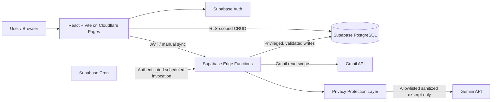
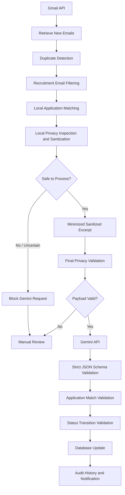

# InternPilot AI — System Design

**Version:** 1.2  
**Status:** Approved MVP architecture  
**Date:** 14 October 2026  
**Related documents:** `proposal.md`, `requirements.md`

## 1. Purpose and Scope

InternPilot AI is a single-user, serverless internship application tracker. Users manually register applications; the system reads newly received Gmail messages and performs recruitment filtering, application matching, privacy inspection, sanitization, and minimization locally. Gemini may classify only an explicitly allowlisted, minimized, sanitized recruitment excerpt after fail-closed privacy validation. The backend treats the response as untrusted and updates records only after schema, match, and status-transition validation. The system also manages deadlines, follow-up reminders, application history, notifications, and retention.

**MVP exclusions:** automatic application creation/submission, automatic sending of follow-up messages, browser push notifications, multi-user workflows, and historical Gmail import by default.

## 2. Confirmed Architectural Decisions

| Decision | MVP choice | Rationale |
|---|---|---|
| Frontend | React, Vite, TypeScript, Tailwind CSS, shadcn/ui | Rapid implementation |
| Frontend hosting | Cloudflare Pages | Static frontend hosting |
| Authentication | Supabase Auth | Session management |
| Application CRUD | React → Supabase client → PostgreSQL with RLS | Fewer backend endpoints |
| Server-side processing | Supabase Edge Functions (TypeScript/Deno) | Secrets and business workflows stay server-side |
| Data | Supabase PostgreSQL | Relational integrity and RLS |
| Email | Gmail API with separate Google OAuth authorization | Read-only access to recruitment messages |
| AI | Gemini API | Classification of privacy-validated, minimized, sanitized recruitment excerpts only |
| Manual and scheduled sync | Same `sync-emails` Edge Function | Shared behavior, different caller authorization |
| AI execution | Sequential, one candidate email at a time | Easier retry/rate-limit management |
| Initial Gmail sync | New messages only | Avoid unnecessary processing; historical mode configurable |
| User notifications | In-app dashboard only | No outbound notifications in MVP |
| Retention | Archive closed after 6 months; delete after 12 months from closure | Conserve storage |

## 3. High-Level Architecture



The frontend never receives Gmail refresh tokens, Gemini API keys, encryption keys, or service-role credentials. The browser uses only the public Supabase URL and publishable/anon key with a signed-in session. Gemini cannot directly access Gmail, Supabase, the database, or any credentials.

## 4. Component Responsibilities

### 4.1 Frontend

- Login/logout and Gmail connection status.
- Create, read, update, delete, search, and filter internship applications.
- Application detail view with history, deadlines, and follow-up state.
- Dashboard summaries, attention queue, archived applications, and notifications.
- `Sync Emails Now` action and last sync result.
- Review queue for unmatched or ambiguous recruitment messages.
- CSV export and manual application deletion with confirmation.

Use TanStack Query optionally for server-state caching. Never trust client-side validation alone.

### 4.2 Supabase Auth and PostgreSQL

- Authenticate the owner and enforce row-level access for user-owned data.
- Enforce required fields, valid status values, uniqueness/idempotency, and foreign keys.
- Maintain immutable/auditable application status-change history using database-side logic or trusted server-side routines; direct CRUD must not allow bypassing history.
- Restrict direct client modification of server-owned fields such as AI processing metadata, Gmail credentials, sync checkpoints, and retention timestamps.
- Provide controlled functions or database triggers for status transitions, archive restoration, and closure timestamps.

**Security boundary:** RLS is necessary but not sufficient. Database constraints, column privileges, and/or `SECURITY DEFINER` routines with tightly controlled execution privileges must protect privileged transitions. Do not expose service-role access to the browser.

### 4.3 Edge Functions

Suggested functions:

```text
supabase/
  functions/
    gmail-oauth-start/
    gmail-oauth-callback/
    sync-emails/
    cleanup-data/
    _shared/
      auth.ts
      gmail.ts
      filter.ts
      privacy-inspection.ts
      ai-payload.ts
      gemini.ts
      ai-response.ts
      matcher.ts
      transitions.ts
      sync-state.ts
      errors.ts
  migrations/
  config.toml
```

`sync-emails` contains duplicate detection, local filtering, privacy inspection, allowlisted payload construction, optional Gemini analysis, response validation, matching, and persistence as internal modules rather than separate network-invoked functions. Follow-up evaluation can run after synchronization, and a scheduled maintenance routine should still evaluate reminders if email sync fails or Gmail is disconnected.

### 4.4 Privacy Protection Layer

The Privacy Protection Layer runs inside Supabase Edge Functions before every Gemini API request. It is a mandatory backend trust boundary, not a frontend preference. It inspects candidate content locally, removes detectable personal identifiers and sensitive information, minimizes the relevant recruitment excerpt, blocks sensitive or uncertain content, constructs a new payload from an explicit allowlist, and validates that final payload immediately before network invocation. Automated regular-expression or AI-based redaction cannot guarantee anonymity, so permitted excerpts retain residual disclosure risk.

If inspection cannot establish safety, the layer fails closed: it does not call Gemini, does not authorize an automatic application change, creates a manual review item when local rules are insufficient, records only a non-sensitive diagnostic reason code, and continues with other eligible messages. Server-side configuration can disable external AI processing entirely.

The email-processing responsibilities are deliberately separated:

| Component | Responsibility |
|---|---|
| 1. Gmail retrieval | Retrieve only the minimum Gmail data needed for local processing using read-only, least-privilege OAuth access. |
| 2. Duplicate detection | Identify previously handled Gmail message IDs before additional processing. |
| 3. Local recruitment filtering | Exclude clearly irrelevant messages and identify candidates without an external AI call. |
| 4. Local application matching | Match using protected identifiers and application context that are never exposed to Gemini; preserve ambiguous matches for review. |
| 5. Privacy inspection | Detect identifiers, sensitive or confidential content, prohibited structures, and uncertainty locally. |
| 6. Sanitized excerpt preparation | Remove identifiers and sensitive content, strip unnecessary text, and retain only the minimum recruitment excerpt needed for classification. |
| 7. Final privacy validation | Enforce the exact request schema and size limits, reject unknown fields or uncertain sanitization, and authorize or block the network call. |
| 8. Gemini classification | Classify only a validated, minimized, sanitized recruitment excerpt when external AI is enabled. |
| 9. AI response and match validation | Enforce a strict response schema, treat model output as untrusted data, and confirm the precomputed local application match remains unique and applicable. |
| 10. Status transition validation | Apply deterministic chronology and supported-transition rules. |
| 11. Database updates | Persist authorized changes atomically through controlled server/database operations. |
| 12. Audit history and notifications | Record non-sensitive provenance and notify the user without retaining raw email content. |

## 5. Data Model (Logical)

| Entity | Core responsibility |
|---|---|
| `applications` | Company, position, submission method, dates, stage, notes, `closed_at`, `archived_at` |
| `email_connections` | Gmail account identity, encrypted refresh token, scopes, sync state |
| `email_events` | Gmail message ID, matched application, classification, extracted metadata, processing result |
| `application_history` | Timestamped changes, source, previous/new values |
| `follow_ups` | Suggested reminders, completion and snooze state |
| `notifications` | In-app alerts and read state |
| `sync_runs` | Start/end, counts, failures, checkpoint outcome |
| `review_items` | Ambiguous/unmatched emails requiring human decision |

`users` are represented by Supabase Auth users; domain tables reference `auth.users.id` where applicable. Exact tables, indexes, and RLS policies belong in `database-design.md`.

**Data minimization:** Complete email bodies and conversations are transient local inputs only when necessary and are never sent to Gemini or written to application logs. Do not retain raw subjects, sanitized excerpts, attachments, personal identifiers, confidential content, or credentials in AI-processing logs. Store only necessary structured metadata, stable Gmail identifiers, non-sensitive reason codes, and processing outcomes. Never log access tokens or secrets. Automated redaction cannot guarantee that free text is anonymous; uncertain sanitization fails closed.

## 6. Gmail Authorization and Connection

1. User signs in to InternPilot via Supabase Auth.
2. User explicitly selects **Connect Gmail**; this is separate from signing into the app.
3. Server starts Google's authorization-code flow with state and PKCE where supported; request the minimum Gmail read scope required.
4. Callback verifies state, exchanges the code server-side, and stores the refresh token encrypted at rest using a server-only encryption key.
5. Read Gmail account identity and establish an initial synchronization checkpoint **without sending older messages to Gemini**.
6. Display connected account and last successful sync time.
7. On disconnect, revoke the grant when possible and delete stored credentials; define whether existing derived application history is retained (default: retained).

**OAuth deployment dependency:** Google's Gmail restricted-scope verification, app testing-user limits, and token lifetime policies may affect deployment. Validate the current Google OAuth requirements before relying on unattended long-term refresh tokens. Do not assume a testing-mode token remains valid indefinitely.

## 7. Email Synchronization

### 7.1 Triggers

- **Scheduled:** daily at 08:00 Asia/Bangkok (01:00 UTC), via Supabase Cron invoking `sync-emails` with a server-side secret or equivalent verified internal identity.
- **Manual:** `Sync Emails Now` invokes the same function with the signed-in user's Supabase JWT.
- Scheduled requests and user requests must be authenticated through **distinct verified paths**, and both must resolve to the authorized owner. Never accept an unverified `user_id` from a request body.
- Prevent concurrent syncs for the same Gmail connection using a database-backed lease/lock; show `already_running` for duplicate triggers.

### 7.2 New-only and Configurable Historical Mode

```dotenv
GMAIL_INITIAL_SYNC_MODE=new_only
GMAIL_INITIAL_SYNC_DAYS=0
GMAIL_SYNC_ENABLED=true
AI_EMAIL_ANALYSIS_ENABLED=true
AI_MAX_EMAILS_PER_SYNC=50
```

Configuration is **server-side**; it is not exposed to the browser. `historical` is a future/configurable mode, not the MVP default. New-only establishes the initial checkpoint at connection time. Use Gmail history IDs or a carefully maintained time/message cursor and pagination, with an explicit fallback for expired Gmail history IDs. Cursor advancement must not skip unprocessed messages.

Setting `AI_EMAIL_ANALYSIS_ENABLED=false` prevents every Gemini API call, including calls initiated by scheduled synchronization. Eligible messages continue through deterministic local processing or manual review.

### 7.3 Processing Pipeline



Authorization, sync locking, retry state, checkpointing, and continuing to the next message surround this per-message pipeline. A duplicate, clearly irrelevant message, failed AI response, ambiguous match, or invalid transition does not automatically update an application. Candidate messages should be processed oldest-first to reduce stale-state regressions.

**Sequential means at most one validated sanitized-excerpt payload is sent to Gemini at a time.** No raw candidate email is sent. Sequential execution helps retry and rate-limit management but is not a privacy control; local sanitization, the allowlist, and final validation are the privacy boundary.

### 7.4 Prefiltering

Use known recruiter/company domains, existing thread associations, recipient/sender patterns, subject hints, and other deterministic signals locally. Exclude obvious promotions, newsletters, and job recommendation digests. Do **not** assume a generic subject means an email is irrelevant. Use a conservative ambiguous-candidate path and permit manual recovery from missed filters. None of these raw identifiers or hints are automatically eligible for Gemini. Gmail message retrieval does not itself consume Gemini tokens.

### 7.5 AI Request Policy

Gemini requests use an explicit allowlist and size limits. An allowed payload may resemble:

```json
{
  "message_excerpt": "Thank you for applying to [COMPANY]. We invite you to interview for the internship role on [DATE].",
  "locale": "en"
}
```

All fields are generated locally and validated before transmission. This example permits only the minimized, sanitized excerpt—not a raw subject, raw email, company identifier, personal identifier, attachment, full message body, complete conversation, authentication credential, token, or unknown field. The serializer creates the request from known typed values and rejects the whole request if an unexpected field, unsafe value, excessive length, or uncertain sanitization is present.

Gemini returns a strict JSON response containing only supported enums, bounded action fields, and validated date values. Validate its schema and allowed values. Model-reported confidence, if supported later, is a heuristic rather than a calibrated probability. Backend rules—not the model—authorize database updates.

### 7.6 Important Architectural Limitation

Automated redaction cannot guarantee complete privacy. Personal identifiers, confidential context, or re-identifying combinations may survive sanitization, while aggressive minimization can remove information needed for accurate classification. The system must disclose this residual risk before live email-to-Gemini processing is enabled and must fail closed whenever safe sanitization cannot be established.

For the MVP:

- Filter irrelevant messages locally before any external AI request.
- Send Gemini only a validated, minimized, sanitized recruitment excerpt.
- When sanitization is uncertain or sensitive content cannot be safely removed, skip Gemini and create a manual review item.
- Never weaken privacy restrictions to improve classification accuracy.

### 7.7 Fail-Closed Behavior

If any privacy check fails:

1. Do not call Gemini.
2. Do not automatically modify application status.
3. Create a manual review item.
4. Record only non-sensitive diagnostic information, such as a policy reason code and timestamp.
5. Continue processing other eligible emails.

### 7.8 Matching and Status Transitions

- Match locally using existing application IDs, company identity, position, known sender/thread, and chronology; never include those protected identifiers in the Gemini request.
- Never create a new application automatically in the MVP.
- If multiple applications match or none match reliably, create a review item; do not update a guessed application.
- Avoid downgrading `Interview` to `Applied` because an older confirmation email is encountered.
- Do not use a single strict numeric ordering for stages: companies can assess and interview in different orders.
- Closed states: `Accepted`, `Rejected`, `Withdrawn`; active stages: `Interested`, `Applied`, `Assessment`, `Interview`, `Offer`.
- Keep communication/action states (e.g. `Waiting`, `Follow-up Required`, `Action Required`) separate from recruitment stages.
- For safe changes, update application, write history, save event, and create notification **in one transaction** (e.g. a controlled PostgreSQL RPC).
- Allow the user to correct an AI-generated status, preserving correction history.

### 7.9 Failure Handling and Idempotency

- Enforce uniqueness for `(gmail_connection_id, gmail_message_id)` or an equivalent stable identity.
- Distinguish completed, ignored, needs-review, and retryable-failure events.
- On transient Gmail/Gemini errors, retry with bounded exponential backoff and respect rate-limit responses.
- If a function approaches execution limits, persist progress and stop safely; the next run resumes.
- Do not advance checkpoints beyond messages that have been durably handled or explicitly queued for retry.
- Keep sync logs concise and never log raw subjects, email bodies, excerpts, attachments, identifiers, tokens, or confidential content.

## 8. Follow-ups, Deadlines, and Notifications

Default reminders based on last meaningful interaction:

| Waiting time | Communication state / behavior |
|---|---|
| 0–13 days | Waiting; no follow-up reminder |
| 14 days | Follow-up suggested |
| 21 days | Follow-up reminder |
| 30+ days | Long-term pending |

These are defaults and can later be made configurable. Never infer rejection from silence. Record assessment, interview, document-request, application, and university deadlines distinctly. Avoid duplicate reminders by storing reminder type, application ID, and triggering interaction/time window. Follow-up drafting uses a local template or, if external AI is enabled, only privacy-validated, minimized, sanitized input. The user reviews the draft and sends it; the system does not send emails.

The dashboard shows application totals, needs-attention items, upcoming deadlines, recent AI activity, connection/sync status, review queue, and archived records. Notifications are **in-app only**.

## 9. Retention and Cleanup

- Set `closed_at` when an application enters `Accepted`, `Rejected`, or `Withdrawn`.
- Archive closed applications **6 months after `closed_at`**; archival is a database state, not necessarily a separate table.
- Permanently delete archived, still-closed applications **12 months after `closed_at`**, without prompting, on the next monthly cleanup.
- Active applications are retained regardless of age.
- Reopening an archived application clears `archived_at` and `closed_at` and removes it from deletion eligibility.
- Delete related history, email events, follow-ups, and notifications according to documented foreign-key rules; ensure orphaned review items are handled.
- Retain minimal Gmail deduplication/sync markers as needed to avoid reprocessing after parent deletion, without retaining full email content.
- Expire AI processing and sync logs after ~30 days and resolved notifications after ~90 days, subject to active operational needs.
- Support CSV export before deletion if initiated by the user; scheduled deletion does **not** require confirmation or automatic export.

Cleanup is invoked monthly by Supabase Cron. Every cleanup action must re-check current status and closure date inside its transaction.

## 10. Security and Privacy

1. **Authentication:** Supabase Auth for users; verify JWTs for manual Edge Function requests.
2. **Authorization:** RLS on all user-facing tables; protect privileged columns and routines.
3. **Secrets:** Store Gemini key, Google OAuth client secret, Gmail token encryption key, and scheduled-job secret only in server-side secrets management.
4. **OAuth:** Separate Gmail authorization from app login; use minimal scopes, state verification, secure callback handling, and revocation on disconnect.
5. **Encryption:** Encrypt Gmail refresh tokens before database storage; plan for key rotation and token replacement.
6. **Least privilege:** Restrict service-role operations and isolate scheduled execution.
7. **Input safety:** Treat email text and Gemini output as untrusted data; validate the AI response schema and prevent prompt injection or model output from controlling privileged actions.
8. **AI privacy:** Never send raw messages, raw subjects, full bodies, complete conversations, attachments, credentials, OAuth tokens, or known personal/sensitive values to Gemini. Permit only minimized, sanitized recruitment excerpts under an explicit input allowlist and fail closed on uncertainty.
9. **Backend enforcement:** Run privacy validation before every external AI request regardless of frontend settings; automated redaction is not an adequate privacy boundary.
10. **Response authority:** Gemini responses cannot directly modify records. Backend matching and transition validation must authorize an atomic write.
11. **Auditability:** Persist source (`manual` / `ai`), Gmail event ID where applicable, timestamp, previous/new status, and non-sensitive outcome/reason codes without raw email content.
12. **Abuse control:** Rate-limit manual sync and prevent overlapping runs.

## 11. Operational Constraints

- Target **$0/month**, conditional on provider free-tier quotas, billing policies, and current plan limits. Verify before deployment.
- Supabase free projects may pause or be subject to resource limits; after resume, sync should recover from the last durable checkpoint.
- Daily processing may need to span multiple invocations if backlog exceeds batch or execution limits.
- Monitor Google OAuth restrictions, Gmail API quotas, Gemini limits, Edge Function limits, database size, and scheduled-job reliability.
- Cloudflare Pages serves the frontend; Supabase handles backend workloads.

## 12. Key Workflows

### 12.1 Manual Application Creation

1. User completes minimal form: company, position, application date, stage.
2. Frontend validates fields; database repeats validation and RLS checks.
3. Database inserts application and creates history entry.
4. Dashboard refreshes and shows the new application.

### 12.2 Automatic Interview Update

1. New recruiter email passes local recruitment filtering and privacy inspection.
2. Local logic extracts the category, action/deadline flags, and protected matching identifiers.
3. If permitted, Gemini classifies only the separately constructed, validated, minimized, sanitized excerpt.
4. Backend validates the AI response, and the local matcher selects exactly one existing application.
5. Transition validator approves `Interview` and checks chronology.
6. Transaction stores the minimal email event, status history, deadline/action, and dashboard notification.

### 12.3 Ambiguous Email

1. Email appears recruitment-related but matches two positions at one company.
2. System stores minimal review metadata and **does not** change either application.
3. Dashboard asks user to select an application or dismiss the event.
4. Confirmed resolution is logged and applied idempotently.

### 12.4 Reopening an Archived Application

1. User opens Archive and selects Restore.
2. Database-controlled operation verifies ownership and updates stage to an active stage.
3. `archived_at` and `closed_at` are cleared, and history is recorded.
4. Monthly cleanup no longer considers the application eligible for deletion.

## 13. API and Database Access Boundaries

| Operation | Access path | Authorization |
|---|---|---|
| Application list/detail/search | Supabase client → DB | User JWT + RLS |
| Application create/edit/delete | Supabase client → DB / controlled RPC | User JWT + RLS + DB validation |
| History and notifications read | Supabase client → DB | User JWT + RLS |
| Gmail connect/callback | Edge Function | OAuth state + signed-in account binding |
| Sync Now | `sync-emails` Edge Function | User JWT, rate limit |
| Scheduled sync | Same `sync-emails` function | Verified internal scheduled secret/identity |
| Privacy inspection and AI payload construction | Internal Edge Function modules | Server-only, explicit allowlist, fail-closed validation |
| AI classification and token handling | Internal Edge Function modules | Server-only credentials; no direct Gmail/database access |
| Scheduled cleanup | `cleanup-data` Edge Function or protected DB routine | Verified internal scheduled identity |

Detailed request/response contracts will be specified in `api-design.md`.

## 14. Implementation Sequence

1. Supabase Auth, database migrations, RLS, and controlled status/history logic.
2. React application CRUD, dashboard, filters, and archive UI.
3. Gmail OAuth and secure connection management; initialize new-only checkpoint.
4. Email retrieval, deterministic filtering, privacy inspection, sanitization/minimization, and final allowlisted payload validation.
5. Optional Gemini classification, strict response validation, local matching, and status-transition validation.
6. Transactional updates, review queue, idempotency, manual and daily sync.
7. Follow-up reminders, monthly cleanup, CSV export, testing, and deployment.

## 15. Architecture Acceptance Criteria

- Signed-in owner can CRUD applications; another account cannot read or modify them.
- No Gmail/Gemini secrets or refresh tokens are exposed to the browser.
- Initial Gmail connection does not process historical emails by default.
- Manual and scheduled sync invoke the same processing pipeline with separate secure caller verification.
- Candidate emails are processed sequentially; Gemini receives only an explicitly allowlisted, minimized, sanitized recruitment excerpt after local and final privacy validation.
- Raw Gmail messages, raw subjects, complete bodies, full conversations, attachments, credentials, OAuth tokens, and detected personal or sensitive information never appear in Gemini requests.
- Documentation and enablement UI acknowledge that automated redaction cannot guarantee complete privacy and that sanitized excerpts retain residual disclosure risk.
- Unsafe, ambiguous, or schema-invalid payloads produce no Gemini call or automatic status change and are routed to manual review with non-sensitive diagnostics.
- Disabling external AI through backend configuration prevents every Gemini request.
- AI-processing logs and outcome records contain no raw email content or secrets.
- Gemini responses cannot directly modify application records and must pass strict response, match, and transition validation.
- Duplicate message deliveries do not cause duplicate status changes or notifications.
- Unmatched/ambiguous messages never modify application stages automatically.
- Older emails do not silently overwrite newer, valid recruitment outcomes.
- Every automatic update is auditable and correctable.
- Sync failures resume without silently losing messages.
- Dashboard-only notifications work; no emails are sent automatically.
- Closed applications archive after 6 months and delete after 12 months; active or reopened records are never deleted by age alone.

## 16. Follow-on Documents

- **Next:** `database-design.md` — concrete PostgreSQL schema, constraints, triggers, RLS, sync cursor, locks, review queue, and retention cascade rules.
- `ai-email-workflow.md` — Gemini prompt/schema, prefilter heuristics, matching and review policy, retry rules.
- `development-plan.md` — implementation tasks and acceptance checks.
- `security-design.md`, `api-design.md`, `testing-plan.md`, `deployment.md` — detailed operational specifications.
